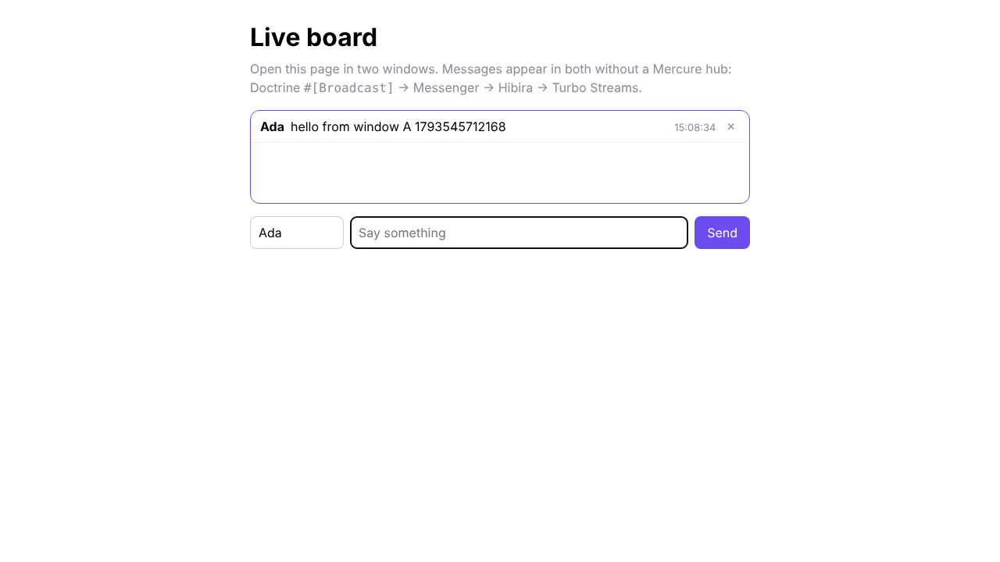
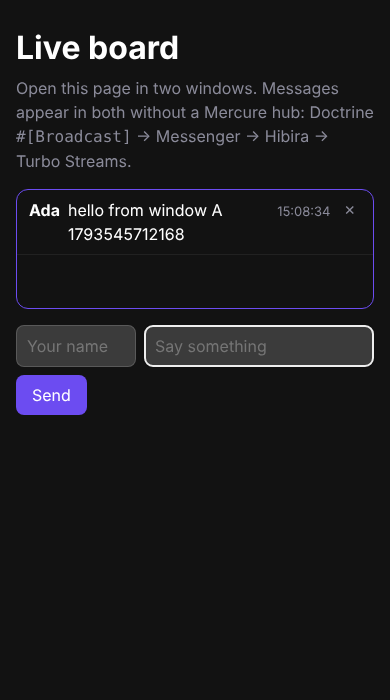

# hibira-io/symfony-bundle

[](https://github.com/hibira-io/symfony/actions/workflows/ci.yml)

Realtime Symfony apps on [Hibira](https://hibira.io), without running a
Mercure hub. Symfony UX Turbo Streams, Doctrine `#[Broadcast]` entities and
Symfony Messenger send their updates to Hibira, and the browser receives
them over WebSockets.

| Desktop | Phone |
| --- | --- |
|  |  |

What the bundle gives you:

- **UX Turbo transport.** `#[Broadcast]` entities, `turbo_stream_listen()`
  and `turbo_stream_from()` / `<twig:Turbo:Stream:From>` work as they do with
  Mercure, with the transport named `hibira`.
- **Messenger.** Every event is a `PublishEvent` message. Route it to an
  async transport and a worker sends it, so a slow network never slows the
  request that saved the entity.
- **Signed channels.** Each Turbo topic is a private channel that a browser
  can only join with the signature the page rendered for it.
- **Size limit handling.** A stream over your plan's event size limit
  becomes a Turbo page refresh instead of an error.
- **Channel auth, webhooks and push.** `POST /hibira/auth` for your own
  private and presence channels, a verified webhook route that dispatches
  Symfony events, and push user tokens for iOS, Android and the web.
- **`bin/console hibira:check`** to check the credentials and connection.

Supports Symfony 6.4, 7.x and 8.x (PHP 8.1+), UX Turbo 2 and 3.

## Install

```sh
composer require hibira-io/symfony-bundle
```

Symfony Flex enables the bundle, adds the Stimulus controller to
`assets/controllers.json` and `pusher-js` to your import map (or
`package.json` with Webpack Encore).

Copy the app ID, key and secret from your app page on
[hibira.io/portal](https://hibira.io/portal) into `.env.local` (the Free plan
needs no card). The secret is shown once, when you create the app or rotate
it.

```ini
HIBIRA_APP_ID=your-app-id
HIBIRA_APP_KEY=your-app-key
HIBIRA_APP_SECRET=your-app-secret
```

Import the routes:

```yaml
# config/routes/hibira.yaml
hibira:
    resource: '@HibiraSymfonyBundle/config/routes.php'
    prefix: /hibira
```

Then check the setup:

```sh
php bin/console hibira:check
```

On your app page, add your site's origin (for example
`https://shop.example.com`) to **Allowed origins**, or browsers can't
connect.

## Configuration

Everything is optional. These are the defaults:

```yaml
# config/packages/hibira.yaml
hibira:
    app_id: '%env(default::HIBIRA_APP_ID)%'
    key: '%env(default::HIBIRA_APP_KEY)%'
    secret: '%env(default::HIBIRA_APP_SECRET)%'
    host: ws.hibira.io        # the WebSocket host on your app page
    port: 443
    scheme: https
    turbo:
        enabled: auto         # on when symfony/ux-turbo is installed
        oversize: refresh     # or "throw"
    messenger:
        enabled: auto         # on when symfony/messenger is installed
        bus: messenger.default_bus
    push:
        instance_id: '%env(default::HIBIRA_PUSH_INSTANCE_ID)%'
        secret_key: '%env(default::HIBIRA_PUSH_SECRET_KEY)%'
        endpoint: https://ws.hibira.io
```

`host`, `port` and `scheme` take env placeholders too, such as
`'%env(int:HIBIRA_PORT)%'`.

## Turbo Streams

Mark an entity with `#[Broadcast]` and give it a stream template, exactly as
in the [UX Turbo docs](https://symfony.com/bundles/ux-turbo/current/index.html#broadcast-doctrine-entities-update):

```php
use Symfony\UX\Turbo\Attribute\Broadcast;

#[ORM\Entity]
#[Broadcast]
class Message
{
    // ...
}
```

```twig
{# templates/broadcast/Message.stream.html.twig #}

<turbo-stream action="append" target="messages">
    <template>{{ include('message/_message.html.twig', { message: entity }) }}</template>
</turbo-stream>



<turbo-stream action="remove" target="message_{{ id }}"></turbo-stream>

```

Listen in a page. A class name follows every entity of that class, an entity
follows that one entity, and any other string is a topic of your own:

```twig
{# UX Turbo 2 and 3 #}
<ul id="messages" {{ turbo_stream_listen('App\\Entity\\Message') }}>

{# UX Turbo 3.1+ #}
{{ turbo_stream_from(message) }}
<twig:Turbo:Stream:From topics="chat" />
```

Without Mercure installed, `hibira` becomes UX Turbo's default transport.
With both, pass it by name: `turbo_stream_listen(topic, 'hibira')`, or set
`turbo.default_transport: hibira`. `#[Broadcast(transports: ['hibira'])]`
limits an entity to Hibira.

Send a stream from anywhere, for example a Messenger handler reporting
progress:

```php
public function __construct(private Hibira $hibira) {}

$this->hibira->turboStream('import-42', '<turbo-stream action="update" target="progress"><template>80%</template></turbo-stream>');
```

Each topic becomes the private channel `private-turbo-<sha256(topic)>`, and
the page carries an HMAC of that name, so a browser can't subscribe to a
topic its page didn't render. Free plans take events up to 4 KB, Hobby and
Starter 10 KB. A stream over the limit is replaced by
`<turbo-stream action="refresh">`, which reloads the page in place (set
`turbo.oversize: throw` to get a `PayloadTooLargeException` instead).

## Messenger

`Hibira::publish()` and every Turbo broadcast dispatch
`Hibira\SymfonyBundle\Message\PublishEvent`. With no routing it is handled
during the request. Route it to a transport to send events from a worker:

```yaml
# config/packages/messenger.yaml
framework:
    messenger:
        transports:
            async: '%env(MESSENGER_TRANSPORT_DSN)%'
        routing:
            Hibira\SymfonyBundle\Message\PublishEvent: async
```

```sh
php bin/console messenger:consume async
```

`Hibira::trigger()` always sends right away.

## Your own channels

```php
use Hibira\SymfonyBundle\Hibira;

$hibira->publish('private-orders.42', 'shipped', ['id' => 42]);
```

Private and presence channels are authorized by `POST /hibira/auth`, which
asks your listeners. Nobody gets in until a listener calls `allow()`:

```php
use Hibira\SymfonyBundle\Event\ChannelAuthorizationEvent;
use Symfony\Component\EventDispatcher\Attribute\AsEventListener;

#[AsEventListener]
final class AuthorizeChannels
{
    public function __invoke(ChannelAuthorizationEvent $event): void
    {
        if ($event->channel === 'private-orders.'.$event->user?->getId()) {
            $event->allow();
        }

        if ($event->channel === 'presence-team' && $event->user !== null) {
            // Member ID defaults to the user identifier.
            $event->allow(memberInfo: ['name' => $event->user->getName()]);
        }
    }
}
```

In the browser, add `{{ hibira_meta_tags() }}` to your layout's `<head>`
and use the shared client:

```js
import { hibira } from "@hibira-io/symfony-bundle/hibira.js"

hibira().subscribe("private-orders.42").bind("shipped", (order) => console.log(order))
```

With AssetMapper, add the module to `importmap.php` once:
`'@hibira-io/symfony-bundle/hibira.js' => ['path' => '@hibira-io/symfony-bundle/hibira.js']`.

## Webhooks

Point your app's webhook at `https://your-site/hibira/webhook`. The bundle
checks `X-Pusher-Signature` (and, during a secret rotation,
`X-Hibira-Previous-Signature`) and dispatches one `WebhookReceivedEvent` per
event:

```php
#[AsEventListener]
public function onWebhook(WebhookReceivedEvent $event): void
{
    if ($event->name === 'member_removed') {
        // $event->channel, $event->payload['user_id']
    }
}
```

## Push notifications

```sh
composer require pusher/pusher-push-notifications
```

```ini
HIBIRA_PUSH_INSTANCE_ID=your-instance-id
HIBIRA_PUSH_SECRET_KEY=your-secret-key
```

```php
$hibira->push()->publishToUsers(['ada'], [
    'web' => ['notification' => ['title' => 'Order shipped', 'deep_link' => 'https://shop.example.com/orders/42']],
]);
```

`GET /hibira/push/token?user_id=...` returns a user token for the signed-in
user, for `setUserId()` in the web, Android and iOS SDKs.

## Coming from Mercure

| Mercure | Hibira |
| --- | --- |
| `symfony/mercure-bundle` and a hub to run | `hibira-io/symfony-bundle`, hosted |
| `MERCURE_URL`, `MERCURE_PUBLIC_URL`, `MERCURE_JWT_SECRET` | `HIBIRA_APP_ID`, `HIBIRA_APP_KEY`, `HIBIRA_APP_SECRET` |
| `turbo_stream_listen(topic)` | unchanged (transport `hibira`) |
| `#[Broadcast]` | unchanged |
| `HubInterface::publish(new Update(...))` | `Hibira::turboStream()` or `Hibira::publish()` |
| `Update` routed through Messenger | `PublishEvent` routed through Messenger |
| Private updates with JWT cookies | Signed private channels, `ChannelAuthorizationEvent` |

## Example

[`example/`](example) is a live board on FrankenPHP: Doctrine
`#[Broadcast]` → Messenger worker → Hibira → Turbo Streams. Put your
credentials in `example/.env.local`, then:

```sh
docker compose -f example/compose.yaml up --build
```

and open <http://localhost:8000> in two windows.

## Development

```sh
composer install
vendor/bin/phpunit
```

## 中文摘要

`hibira-io/symfony-bundle` 讓 Symfony 專案不用自己架 Mercure hub，就能用
[Hibira](https://hibira.io) 推送即時更新：

- **UX Turbo**：`#[Broadcast]` 實體、`turbo_stream_listen()`、
  `turbo_stream_from()` 照原本寫法使用，傳輸名稱為 `hibira`。每個 topic
  都是帶簽章的私有頻道。超過方案單一事件大小上限（Free 4 KB）時，自動改送
  Turbo 頁面重新整理。
- **Messenger**：所有事件都是 `PublishEvent` 訊息，路由到 async transport
  就會改由 worker 發送。
- **頻道授權、Webhook、推播**：`POST /hibira/auth`（以
  `ChannelAuthorizationEvent` 決定）、驗證簽章的 webhook 路由（派發
  `WebhookReceivedEvent`）、推播 user token。
- 安裝：`composer require hibira-io/symfony-bundle`，在 `.env.local` 填入
  `HIBIRA_APP_ID` / `HIBIRA_APP_KEY` / `HIBIRA_APP_SECRET`，匯入路由後執行
  `php bin/console hibira:check`。記得在應用頁面的 Allowed origins 加入網站網域。
- 支援 Symfony 6.4、7.x、8.x（PHP 8.1+），UX Turbo 2 與 3。
  `example/` 是跑在 FrankenPHP 上的即時留言板範例。
